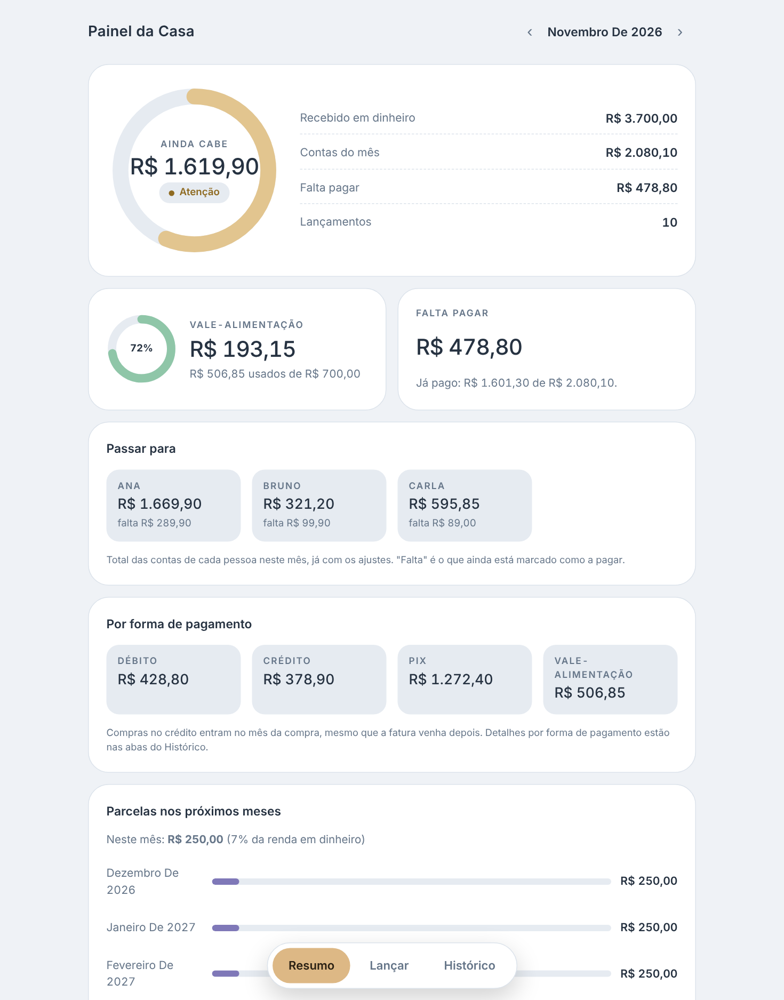
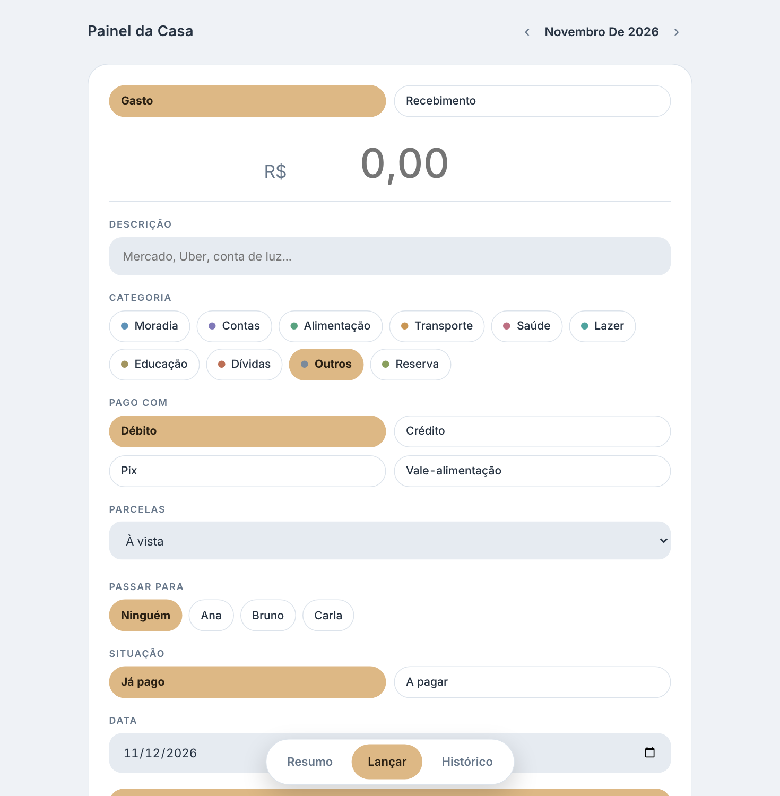
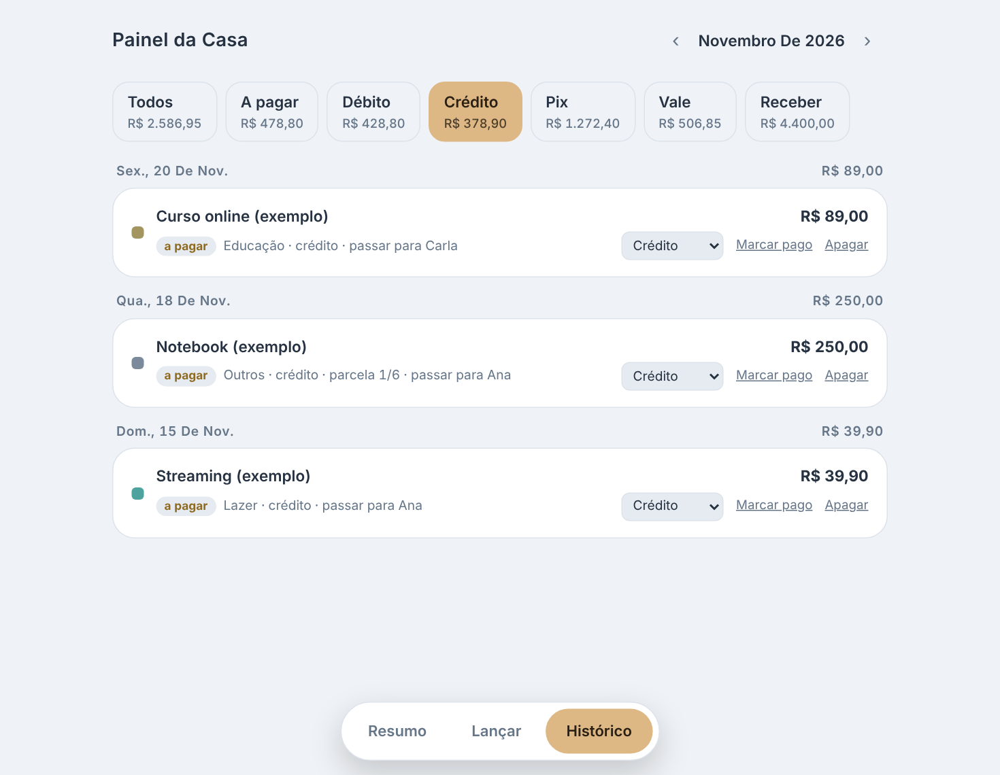
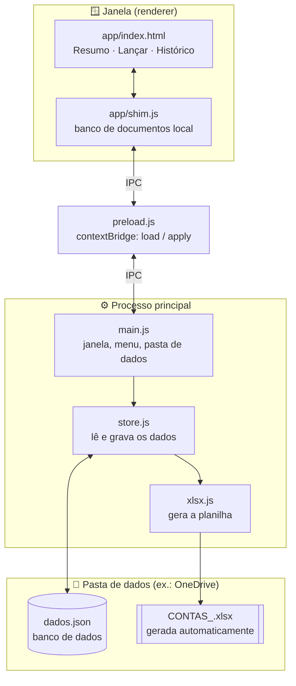
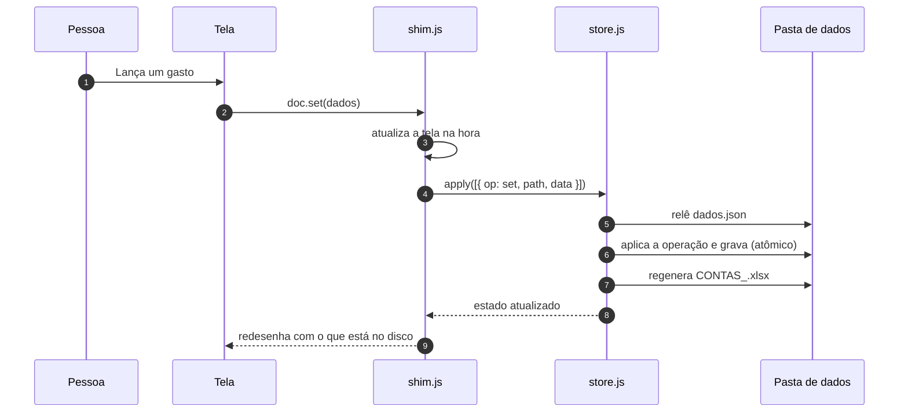
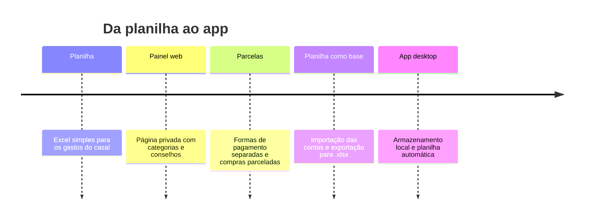

<div align="center">


<br>


<br>



<sub>🌐 Também há uma **página do projeto** com fundo em degradê em [`docs/index.html`](docs/index.html) (veja abaixo como publicá-la).</sub>

</div>

<br>

> ## ⚠️ Todos os dados deste repositório são fictícios
> Os nomes (**Ana, Bruno e Carla**), os valores, as descrições e as datas que aparecem no código, no `seed/dados.json`, nas imagens e neste README são **inventados, apenas para exemplo**.
> Este repositório **não contém nenhuma informação pessoal ou financeira real**: nenhum nome verdadeiro, conta, saldo, dívida ou lançamento de pessoa alguma.
> Os arquivos com dados de quem usa o app (`dados.json` e `CONTAS_.xlsx`) ficam **só no computador do usuário** e estão no `.gitignore`, para nunca serem enviados ao GitHub por engano.

---

## 📑 Sumário

- [✨ O que ele faz](#-o-que-ele-faz)
- [🖼️ Telas](#️-telas)
- [🧰 Tecnologias](#-tecnologias)
- [🏗️ Arquitetura](#️-arquitetura)
- [🧠 Decisões de projeto](#-decisões-de-projeto)
- [🗂️ Modelo de dados](#️-modelo-de-dados)
- [📁 Estrutura do projeto](#-estrutura-do-projeto)
- [🚀 Como usar](#-como-usar)
- [🩺 Problemas comuns](#-problemas-comuns)
- [⚠️ Limitações](#️-limitações)
- [🔒 Privacidade](#-privacidade)
- [🕰️ Histórico do projeto](#️-histórico-do-projeto)

---

## ✨ O que ele faz

| | Recurso | Detalhe |
|---|---|---|
| 🧾 | **Lançar gastos** | Valor, descrição, categoria, forma de pagamento, data, para quem passar e situação (já pago ou a pagar). |
| 💳 | **Formas de pagamento** | Débito, crédito, Pix e vale-alimentação, com abas separadas no histórico. É possível trocar a forma depois, sem apagar o lançamento. |
| 🔁 | **Compras parceladas** | Informe o total (ou o valor da parcela) e o número de parcelas: o app cria uma parcela por mês nos meses seguintes. Ao apagar, remove só uma parcela ou todas. |
| 💵 | **Recebimentos manuais** | Lançados mês a mês, porque o valor varia. Em dinheiro ou em vale-alimentação. |
| 📊 | **Resumo do mês** | Quanto ainda cabe, quanto falta pagar, totais por forma de pagamento, por categoria e por pessoa, parcelas dos próximos meses e comparação mês a mês. |
| 🧭 | **Conselhos financeiros** | Dicas baseadas em boas práticas (peso das parcelas na renda, reserva de emergência, "pague-se primeiro", limites por categoria), calculadas a partir dos lançamentos. |
| ✅ | **Controle de pagamento** | Marque cada conta como paga ou a pagar e veja o que ainda falta no mês. |
| 📗 | **Planilha automática** | A cada alteração, o app regenera o `CONTAS_.xlsx` com todos os lançamentos, o resumo mensal por categoria e menus de listas. |
| 👥 | **Uso a dois** | Os dados ficam numa pasta sincronizada (por exemplo, OneDrive); cada pessoa usa o app no seu computador. |

---

## 🖼️ Telas

<table>
  <tr>
    <td align="center"><b>Lançar</b><br><sub>gasto ou recebimento, com parcelas</sub></td>
    <td align="center"><b>Histórico</b><br><sub>abas por forma de pagamento</sub></td>
  </tr>
  <tr>
    <td></td>
    <td></td>
  </tr>
</table>

<sub>Capturas feitas com os dados fictícios de `seed/dados.json`.</sub>

---

## 🧰 Tecnologias

| Camada | Tecnologia | Para quê |
|---|---|---|
| 🖥️ Desktop | [Electron](https://www.electronjs.org/) | Janela do app, menu, acesso à pasta de dados; `preload` com `contextBridge` e janela isolada (`contextIsolation`, `sandbox`). |
| 🎨 Interface | HTML, CSS e JavaScript puro | Telas sem framework; gráficos em SVG. |
| 📦 Empacotamento | [electron-builder](https://www.electron.build/) | Gera um executável portátil (`.exe`) que não precisa de instalação. |
| 💾 Armazenamento | Arquivo JSON local | Banco de dados simples, com escrita atômica. |
| 📗 Planilha | Gerador próprio de `.xlsx` | Office Open XML + ZIP escritos à mão, sem bibliotecas. |
| ⚙️ Runtime | [Node.js](https://nodejs.org/) | Processo principal e ferramentas de build. |

---

## 🏗️ Arquitetura



### Fluxo de um lançamento



---

## 🧠 Decisões de projeto

<details>
<summary><b>♻️ Reaproveitar a interface original</b></summary>

A tela foi criada para rodar dentro do Claude, que oferece um banco de documentos (`collection`, `doc`, `onSnapshot`). Em vez de reescrever, o `app/shim.js` implementa essa mesma interface em cima do armazenamento local. Assim, a tela funciona igual nos dois ambientes.
</details>

<details>
<summary><b>🧩 Operações em vez de "salvar tudo"</b></summary>

Cada alteração é enviada como uma operação (`set`, `update`, `delete`). O `store.js` **relê o arquivo antes de aplicar**, para não apagar o que a outra pessoa lançou enquanto o app estava aberto. A janela também relê os dados quando volta ao foco e a cada 30 segundos.
</details>

<details>
<summary><b>🛡️ Escrita atômica</b></summary>

O arquivo é gravado em um temporário e depois renomeado, para não corromper os dados se o computador desligar no meio da gravação.
</details>

<details>
<summary><b>📗 Planilha sem biblioteca</b></summary>

O `xlsx.js` monta o arquivo Office Open XML e o ZIP manualmente: tabela do Excel, validações de lista, formatação condicional e fórmulas `SUMIFS` já com o valor calculado. O resultado foi conferido recalculando a planilha no LibreOffice, comparando com os valores gravados.
</details>

<details>
<summary><b>🚫 Nada de sobrescrever à mão</b></summary>

O `dados.json` é a fonte da verdade e a planilha é sempre gerada a partir dele. Ninguém precisa editar nem mesclar o Excel.
</details>

---

## 🗂️ Modelo de dados

O arquivo `dados.json` tem três coleções:

```json
{
  "versao": 1,
  "gastos": {
    "ex001": {
      "valor": 250,
      "descricao": "Notebook (exemplo)",
      "categoria": "Outros",
      "meio": "credito",
      "data": "2026-11-18",
      "pago": false,
      "para": "Ana",
      "parcela": 1,
      "parcelas": 6,
      "grupo": "ex-notebook"
    }
  },
  "receitas": {
    "exr1": { "valor": 2800, "descricao": "Salário (exemplo)", "tipo": "din", "data": "2026-11-05" }
  },
  "config": { "base": { "reserva": 1500 } }
}
```

| Campo | Valores |
|---|---|
| `meio` | `debito`, `credito`, `pix`, `va` (vale-alimentação) |
| `categoria` | Moradia, Contas, Alimentação, Transporte, Saúde, Lazer, Educação, Dívidas, Outros, Reserva |
| `tipo` (recebimento) | `din` (dinheiro) ou `va` (vale-alimentação) |
| `tipo: "ajuste"` (gasto) | abatimento com valor negativo, que não entra nas categorias |
| `grupo` | liga as parcelas de uma mesma compra |

---

## 📁 Estrutura do projeto

```
painel-da-casa/
├── main.js          processo principal do Electron (janela, menu, pasta de dados)
├── preload.js       ponte segura entre a janela e o processo principal
├── store.js         leitura/escrita do dados.json e geração da planilha
├── xlsx.js          gerador de .xlsx (Office Open XML + ZIP)
├── app/
│   ├── index.html   interface (Resumo, Lançar, Histórico)
│   └── shim.js      banco de documentos local usado pela interface
├── seed/
│   └── dados.json   dados de exemplo (fictícios), copiados na primeira execução
├── docs/            banner, capturas de tela e a página do projeto (index.html)
└── package.json     scripts e configuração do electron-builder
```

---

## 🚀 Como usar

**Requisito:** [Node.js](https://nodejs.org/) (versão LTS) no Windows.

```bash
npm install        # instala as dependências
npm start          # abre o app em modo de teste
npm run build      # gera dist/Painel-da-Casa.exe (portátil, não precisa instalar)
```

### Onde ficam os dados

`C:\Users\<usuário>\OneDrive\Documentos\Contas a Pagar` (ou `Documentos\Contas a Pagar`, se não houver OneDrive). O caminho aparece na barra de título, e o menu **Arquivo → Escolher outra pasta de dados** permite trocar.

| Arquivo | Função |
|---|---|
| `dados.json` | O banco de dados. Não apague nem edite. |
| `CONTAS_.xlsx` | A planilha, regenerada sozinha a cada lançamento. Abra só para consultar. |

### Começar do zero (sem os exemplos)

Antes de gerar o `.exe`, troque o conteúdo de `seed/dados.json` por:

```json
{ "versao": 1, "gastos": {}, "receitas": {}, "config": {} }
```

Se o app já tiver criado a pasta de dados com os exemplos, apague-os pelo próprio app (aba **Histórico → Apagar**), ou troque o conteúdo do `dados.json` da pasta de dados pelo JSON acima com o app fechado. (Apagar o arquivo faz o app copiar os exemplos de novo.)

### Uso a dois

Cada pessoa usa o app no seu computador, apontando para a mesma pasta sincronizada. Ao voltar para a janela, o app relê o arquivo. Evite lançar ao mesmo tempo e deixe o OneDrive terminar de sincronizar antes de abrir.

### Personalizar os nomes

Os nomes do campo "Passar para" estão no código (`Ana`, `Bruno` e `Carla`, fictícios). Troque a constante `PARA` em `app/index.html` e a lista `PARAL` em `xlsx.js`. Se já houver dados, ajuste também o campo `para` no `dados.json`.

---

## 🌐 Página do projeto

O arquivo [`docs/index.html`](docs/index.html) é uma página estática (sem animações) que apresenta o projeto. Para publicá-la no GitHub Pages: **Settings → Pages → Build and deployment → Source: *Deploy from a branch* → Branch: `main` / pasta `/docs` → Save**. Depois de alguns minutos ela fica em `https://<usuário>.github.io/painel-da-casa/`.

---

## 🩺 Problemas comuns

| Sintoma | O que fazer |
|---|---|
| Erro de *link simbólico* ou permissão no `npm run build` | Ative o **Modo de Desenvolvedor** do Windows ou rode o terminal como administrador. |
| `npm` não é reconhecido | Instale o Node.js e **reabra** o terminal (ou o VS Code) para atualizar o PATH. |
| Aviso azul do SmartScreen ao abrir o `.exe` | Esperado: o programa não tem assinatura digital. Clique em **Mais informações → Executar assim mesmo**. |
| "Planilha aberta no Excel" | O lançamento é salvo, mas a planilha só atualiza depois que você fechar o arquivo e lançar de novo. |

---

## ⚠️ Limitações

- Alterações feitas direto no Excel **não voltam** para o app: a planilha é só para consulta.
- Duas pessoas lançando ao mesmo tempo em computadores diferentes podem gerar conflito de sincronização do OneDrive.
- Sem assinatura digital do executável e sem atualização automática.
- Os conselhos são sugestões gerais e **não** substituem uma recomendação financeira personalizada.

---

## 🔒 Privacidade

- Não há servidor, conta, login nem telemetria: os dados nunca saem do computador, a não ser pela pasta sincronizada que você escolher.
- O `.gitignore` impede o envio de `dados.json` e `CONTAS_.xlsx` para o repositório.
- Os dados de `seed/dados.json` são fictícios.

---

## 🕰️ Histórico do projeto



---

<div align="center">

Desenvolvido com apoio do [Claude](https://claude.ai) (Anthropic).

</div>
